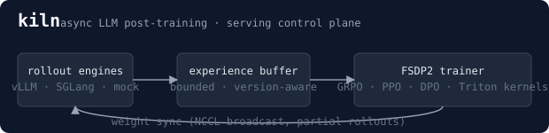
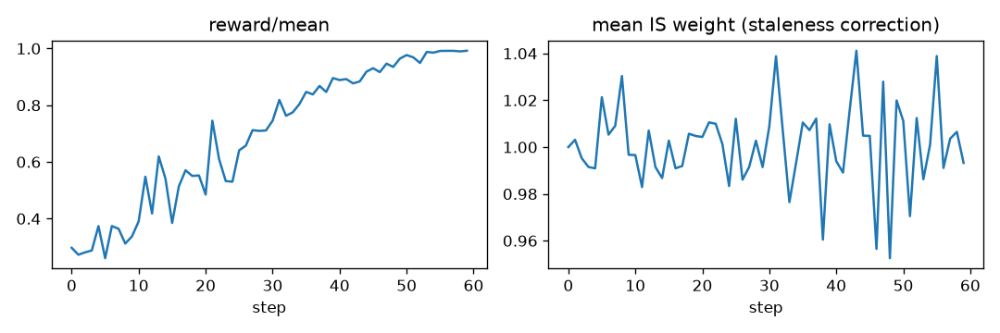

<p align="center"> experience buffer -> FSDP trainer -> weight sync"></p>

# Kiln

**An asynchronous LLM post-training and serving stack: GRPO / PPO / DPO on FSDP2, with vLLM / SGLang rollouts, fused Triton and CUDA C++ kernels, and the serving control plane to ship the result.**

[](https://github.com/Priyanshusingh09876/Kiln/actions/workflows/ci.yml)


```bash
pip install torch && pip install --no-build-isolation -e ".[dev]"   # builds the C++ ext; CUDA ext too if nvcc is present
pytest -q                                   # ~170 tests, a few min on a laptop CPU, no GPU needed
kiln train configs/tiny_cpu_smoke.yaml      # the full async GRPO loop end-to-end on CPU
python examples/01_async_grpo_cpu.py        # same, with a learning curve
kiln train configs/grpo_math_qwen3_8b.yaml --ray   # 8 trainer GPUs + 4 vLLM engines (not yet run, see Status)
```

> Windows without a C++ compiler: `set KILN_SKIP_NATIVE=1` (PowerShell: `$env:KILN_SKIP_NATIVE="1"`) before `pip install -e ".[dev]"`. Everything runs; the native-extension tests skip.

## Highlights

- **Fused Triton log-prob + entropy kernel: 4.0× faster than `torch.compile`, 15× faster than PyTorch, at 73–86% of
  the GPU's measured memory bandwidth**, using 10× less memory (1.0 GB, just the gradient buffer, vs 10 GB) at a 128k
  vocabulary. 1.4× faster than Liger Kernel's cross-entropy while also computing entropy. Tuning made it 2.0× faster
  than the first version. RTX 3080 Ti, bf16, forward + backward, checked against float64.
  [Results](docs/benchmarks/kernels_rtx3080-laptop-v2.md) · [Tuning sweep](docs/benchmarks/tune_logprob_rtx3080-laptop.md)
- **First GPU bring-up: 22 failing tests → 5 root causes → all fixed.** The two that CPU CI could never see now have
  CPU-side guards (Triton interpreter run, source-level encoding check).
  The worst was one line: a comment had swallowed `+ tl.sum(e)`, so the kernel returned `+inf` and every training
  run went NaN. [Write-up](docs/gpu-bringup.md)
- **Async rollout/training reaches the target reward 2.0× sooner** than synchronous training, with bounded
  staleness and importance-weight correction (scheduling simulation, reproduced on two machines).
  [Results](docs/benchmarks/sync_vs_async_rtx3080-laptop.md)
- **Bit-exact checkpoint resume**, tested across processes and across two FSDP2 ranks; a prefix-cache-aware
  router (C++ core) that raised cache hit rate from 53% to 89% under load; canary rollouts with automatic rollback.
- **Every claim has evidence or is marked as not done.** 20 bugs found and documented in
  [`docs/STATUS.md`](docs/STATUS.md), including what is still slow or untested — for example, `torch.compile` still
  beats my RMSNorm and RoPE kernels.

## Status

**Tested on CPU on every commit; the full suite and the Triton kernels also run on one GPU (RTX 3080 Ti
Laptop).** The algorithms, the async loop, checkpointing and exact resume, data-parallel FSDP2 across real
processes, the reward server, the router, the canary controller and the gateway are all exercised by the
test suite. The first GPU run failed 22 tests; the five bugs behind them are fixed and listed in
[`docs/STATUS.md`](docs/STATUS.md) (#16–20). Not yet run on GPUs: the CUDA C++ kernels (not built with nvcc
yet), vLLM/SGLang engines, NCCL weight sync, the Ray runtime, and anything multi-GPU. Tensor, pipeline and context parallelism are not implemented. Every component and its
evidence is listed in [`docs/STATUS.md`](docs/STATUS.md); the plan and results log for GPU and
multi-node validation are in [`docs/VALIDATION.md`](docs/VALIDATION.md).

## Why this exists

RL post-training has a structural inefficiency: one optimizer step waits for
the *slowest* rollout in the batch, and with reasoning models response
lengths are heavy-tailed. Kiln decouples generation from training with a
bounded, version-aware experience buffer and corrects the resulting
off-policy-ness with truncated importance weights — so trainer GPUs are never
idle on the length tail, and the math stays right. Everything around that
loop (weight sync into live engines, async atomic checkpoints, fused
kernels for the per-token log-prob hot path, a reward server, a
cache-aware inference gateway with SLO-gated canaries) is here because a
training loop without them does not run for three days on 64 GPUs.

## Architecture

```
            prompts (JSONL/Parquet, sharded, seeded)
                         │
      ┌──────────────────┼───────────────────┐
      ▼                  ▼                   ▼
 RolloutWorker 0    RolloutWorker 1     RolloutWorker k     each drives one engine:
 [vLLM tp=1]        [vLLM tp=1]         [SGLang http]       vLLM · SGLang · in-process mock
      │ generate() → samples tagged with policy_version
      │ reward_fn()  → rules / HTTP reward server / reward model
      ▼                  ▼                   ▼
 ┌──────────────────────────────────────────────────┐
 │ ExperienceBuffer   capacity = queue_depth (adaptive)│  put() blocks when full (back-pressure)
 │                    drops batches older than         │  get() returns oldest fresh batch
 │                    max_staleness versions           │  every drop is counted and exported
 └──────────────────────────┬───────────────────────┘
                            ▼
 ┌──────────────────────────────────────────────────┐
 │ PolicyTrainer (data-parallel FSDP2)              │  1. old_logp / ref_logp (no-grad, packed)
 │   algorithm: GRPO · Dr.GRPO · RLOO · REINFORCE++ │  2. advantages (group stats / GAE)
 │              · PPO (+critic) · DPO (offline)      │  3. clipped surrogate × IS weights, KL, entropy
 │   kernels:   fused logprob+entropy, RMSNorm, RoPE,│  4. clip grads, optimizer step
 │              FP8 block GEMM (CUDA C++ · Triton ·  │  5. policy_version += 1
 │              torch reference, parity-tested)      │
 └──────────────────────────┬───────────────────────┘
                            ▼
      WeightSyncer  (inproc | CPU/Ray | NCCL broadcast into live vLLM workers, bucketed, LoRA-only option)
                            │  partial rollouts: pause → swap → resume, no drained queue
                            ▼
                     engines keep generating with the new weights
      ╰── every N steps: AsyncCheckpointer (pinned-host copy → background write → atomic rename)
```

## Does it learn?

`python examples/01_async_grpo_cpu.py` — async GRPO on a 50K-parameter model, CPU only, about ten seconds on a laptop:

<p align="center"></p>

```
reward every 10 steps: [0.335, 0.495, 0.688, 0.903, 0.989, 0.991]
mean staleness: 1.92
```

Reward goes 0.33 → 0.99 while every batch the trainer consumed was ~2 policy
versions stale — the asynchronous loop with importance-weight correction
learns as well as the synchronous one. `tests/test_e2e.py` asserts this on
every CI run; if any link in the alignment chain is off by one, the curve
stays flat and the build fails.

## Benchmarks

All numbers below were produced by the scripts named, and each report says what it does and does not
measure. Raw JSON for every table is next to it in [`docs/benchmarks/`](docs/benchmarks).

**Kernels on a GPU** — [`docs/benchmarks/kernels_rtx3080-laptop-v2.md`](docs/benchmarks/kernels_rtx3080-laptop-v2.md),
`scripts/bench_kernels.py`, NVIDIA RTX 3080 Ti Laptop (16 GB, 58 SMs, sm_86), Windows, torch 2.14 + CUDA 12.6.
Forward + backward through autograd, median of 20 iterations, every Kiln row within tolerance of a float64
reference. Bandwidth is the minimum bytes the operation must move divided by its time, as a share of this GPU's
measured copy bandwidth (418 GB/s; spec sheet 448 GB/s).

Fused log-prob + entropy, bf16:

| shape (tokens × vocab) | PyTorch | `torch.compile` | Liger (CE only) | **Kiln Triton** | vs compile | % of copy BW | peak memory PyTorch → Kiln |
|---|---|---|---|---|---|---|---|
| 4096 × 32k | 38.9 ms | 8.7 ms | 3.9 ms | **2.2 ms** | 4.1× | 87% | 2.5 GB → 0.25 GB |
| 4096 × 128k (Llama-3) | 153.6 ms | 40.9 ms | 14.7 ms | **10.3 ms** | 4.0× | 73% | 10.0 GB → 1.0 GB |
| 2048 × 152k (Qwen) | 91.2 ms | 20.8 ms | 7.2 ms | **5.3 ms** | 3.9× | 84% | 5.9 GB → 0.59 GB |
| 256 × 128k | 11.4 ms | 4.1 ms | 1.5 ms | **0.90 ms** | 4.6× | 53% | 630 MB → 63 MB |
| 64 × 152k | 3.5 ms | 1.1 ms | 1.1 ms | 1.4 ms | 0.79× | 10% | 190 MB → 19 MB |

Kiln's peak memory is the gradient buffer and nothing else. Liger computes cross-entropy only (no entropy) and
overwrites the logits with the gradient, so it does less work and needs no buffer; it is a reference point, not a
like-for-like match. Liger also returns the per-token loss in bf16, which is why its bf16 rows fail the float64
check on the log-prob (error 0.06); its gradients are within tolerance.

**Where Kiln does not win**, from the same run:

| kernel, bf16 | `torch.compile` | Kiln Triton | Kiln vs compile |
|---|---|---|---|
| RMSNorm 16384 × 4096 | 2.8 ms | 4.3 ms | 0.66× |
| RMSNorm 8192 × 8192 | 3.5 ms | 4.3 ms | 0.81× |
| RoPE 4 × 4096 × 32 × 128 | 4.5 ms | 4.7 ms | 0.94× |
| log-prob 64 × 152k (tiny batch) | 1.1 ms | 1.4 ms | 0.79× |

The RMSNorm kernel reaches 37% of copy bandwidth and RoPE 27%; they have not been tuned yet. At 64 tokens
everything is launch-overhead-bound, and Kiln's split-row heuristic picked a configuration the sweep showed to be
slower (since changed, not yet re-measured). In fp32 at 4096 × 128k, Liger is faster (16.1 vs 21.6 ms); Kiln is
faster at the other fp32 shapes.

**Tuning: v1 → v2** — [`docs/benchmarks/tune_logprob_rtx3080-laptop.md`](docs/benchmarks/tune_logprob_rtx3080-laptop.md),
`scripts/tune_fused_logprob.py`, kernel timings from `triton.testing.do_bench`:

| shape, bf16 | v1 | v2 (shipped, through autograd) | speedup | % of copy BW |
|---|---|---|---|---|
| 4096 × 128k | 18.0 ms | 8.8 ms | 2.1× | 86% |
| 2048 × 152k | 14.5 ms | 6.2 ms | 2.3× | 72% |
| 256 × 128k | 1.21 ms | 0.56 ms | 2.2× | 84% |
| 64 × 152k | 0.37 ms | 0.33 ms | 1.1× | 42% |

Most of the gain is the backward: v1 wrote an fp32 gradient and converted it to bf16 in a second pass, moving
three times the bytes. Both versions ran at about 420 GB/s; v2 simply moves less (15.0 → 5.0 ms at 4096 × 128k).
Retuning block size and warps took the forward from 3.06 to 2.44 ms. Splitting rows across programs never won at
these shapes. The v1 numbers are in [`kernels_rtx3080-laptop.md`](docs/benchmarks/kernels_rtx3080-laptop.md).

The PyTorch fallback (`KILN_KERNEL_BACKEND=torch`, used only without Triton) is now chunked over tokens: at
4096 × 128k in bf16 it went from 1.4 s and 16.0 GB to 176 ms and 2.3 GB, on par with PyTorch speed at 4.4× less
memory.

**Sync vs async GRPO, reproduced on a second machine** — [`docs/benchmarks/sync_vs_async_rtx3080-laptop.md`](docs/benchmarks/sync_vs_async_rtx3080-laptop.md):
async with queue depth 4 reached reward 0.8 **2.0× sooner** (16.0 vs 31.4 s) and the trainer was busy 54% of
wall time instead of 5%, consistent with the run below. Same scheduling simulation, so this confirms the
scheduling result, not GPU throughput.

**Sync vs async GRPO** — [`docs/benchmarks/sync_vs_async_cpu-sim.md`](docs/benchmarks/sync_vs_async_cpu-sim.md),
`scripts/bench_sync_vs_async.py`, 3 seeds. A *scheduling simulation*: 4 mock engines with a heavy-tailed
decode-latency model stand in for GPU generation; training is real. Synchronous mode splits each batch
across all engines, as verl does.

| mode | time to reward ≥ 0.8 | trainer busy | final reward | batches dropped as stale |
|---|---|---|---|---|
| sync | 30.5 ± 3.1 s | 4% | 0.991 | 0% |
| async, queue depth 2 | 16.0 ± 3.2 s (1.9× sooner) | 24% | 0.979 | 43% |
| async, queue depth 4 | 12.7 ± 2.7 s (2.4× sooner) | 33% | 0.959 | 20% |

Async reaches the target reward about twice as fast in wall time at slightly lower reward per step. The
dropped column is the cost of a queue shallower than the number of engines.

**Gateway under load** — [`docs/benchmarks/gateway_demo.md`](docs/benchmarks/gateway_demo.md),
`examples/04_gateway_canary_demo.py`. Real gateway, router and canary controller over HTTP; replicas
simulate an engine with a prefix cache. Prefix-aware routing raised the replica cache hit rate from 53% to
89% and throughput by 27% versus least-loaded routing, at the cost of balance (busiest replica 37% of
traffic vs 25%). A canary that turned 3× slower at 25% of traffic was rolled back automatically. Judging a
canary against the warm fleet rolled back a *healthy* build; comparing it with a matched control fixed that.

**Kernels on CPU** — [`docs/benchmarks/kernels_cpu.md`](docs/benchmarks/kernels_cpu.md): reference paths
only (all within tolerance of a float64 reference). GPU results are at the top of this section; the CUDA C++
kernels still need an nvcc build to be timed.

## What's inside

| Area | Module | What it does |
|---|---|---|
| Algorithms | `kiln/algorithms` | GRPO, Dr. GRPO, RLOO, REINFORCE++, PPO with GAE + clipped value loss, DPO/IPO/hinge. DAPO clip-higher, dual-clip, token / sequence / length-unbiased loss aggregation, k1/k2/k3 KL, adaptive KL controller, KL-in-reward or KL-in-loss. |
| Async loop | `kiln/orchestration` | Version-aware `ExperienceBuffer`, `RolloutWorker`, `StalenessController` (adaptive queue depth), `AsyncController`; Ray runtime with placement groups, colocated or disaggregated layouts. |
| Trainer | `kiln/trainer`, `kiln/distributed` | Data-parallel FSDP2 (`fully_shard` per block, mixed precision, activation checkpointing), tested across real processes on CPU; offline DPO trainer; sequence packing with first-fit-decreasing and block-diagonal masks; MFU accounting that counts the forward-only passes honestly. Tensor/pipeline/context parallelism: not implemented (configs requesting them are rejected). |
| Rollouts | `kiln/rollout` | Engine contract (`generate / update_weights / pause / resume / sleep / wake`); vLLM engine with an in-worker extension for NCCL weight receive and in-place `load_weights` (KV cache and CUDA graphs survive); SGLang HTTP engine; mock engine for CPU tests. |
| Kernels | `kiln/kernels`, `csrc/` | Single-pass online-softmax log-prob + entropy (fwd + bwd, never materialises `[N,V]` probs), RMSNorm, RoPE with arbitrary positions, DeepSeek-style FP8 block-scaled GEMM — in Triton, plus **CUDA C++** versions of the two hottest (log-prob/entropy, RMSNorm) with warp-shuffle reductions and fp16/bf16/fp32 dispatch. Every kernel has a PyTorch reference path and a parity test; `KILN_KERNEL_BACKEND` pins CUDA / Triton / torch against each other. |
| Rewards | `kiln/reward` | Composable rule verifiers (`\boxed{}` math with fraction/sympy equivalence, format, repetition, length, sandboxed Python unit tests), FastAPI reward server with Prometheus metrics, retrying batched client, reward-model scorer. |
| Checkpointing | `kiln/checkpoint` | Async, atomic, rank-sharded; safetensors for weights; back-pressure; writer errors surfaced, never swallowed. |
| Serving | `kiln/serving`, `csrc/radix_tree.cpp` | Prefix-cache-aware router (block radix tree + load cap; **C++ core** with zero-copy NumPy entry points, differential-tested against the Python reference), continuous-batching scheduler with paged KV, chunked prefill and youngest-first preemption (doubles as a capacity-planning simulator), SLO-gated canary controller, OpenAI-compatible gateway. |
| Ops | `configs/`, `deploy/`, `.github/` | Strict pydantic YAML schema with env expansion and CLI overrides; KubeRay job, reward server with no-egress NetworkPolicy, gateway deployment; Slurm scripts; CI with lint, CPU tests on two Pythons, host-side CUDA type-check, 2-process FSDP2 test, perf-regression gate; a GPU job is defined but needs a self-hosted GPU runner, which is not attached yet. |

## Design notes

The four ADRs in [`docs/design/`](docs/design) explain the decisions that are
not obvious from the code:

1. [Asynchronous training with bounded staleness](docs/design/01-async-training.md) — why a bounded buffer, how importance weighting keeps it correct, how depth adapts.
2. [Fused kernels](docs/design/02-kernels.md) — the online-softmax log-prob/entropy kernel and its one-pass backward, the CUDA C++ versions, FP8 block scaling, why not Liger / `torch.compile`.
3. [Weight sync and checkpointing](docs/design/03-weight-sync-and-checkpointing.md) — NCCL broadcast into live engine workers, pinned-buffer async checkpoints with atomic publish.
4. [Serving control plane](docs/design/04-serving.md) — cache-aware routing, scheduler simulator, canary guardrails.

`csrc/README.md` documents the native extensions and how they are built and tested.

## Running things

```bash
# validate every shipped config against the strict schema
kiln validate configs/*.yaml

# override anything from the CLI
kiln train configs/grpo_math_qwen3_8b.yaml --set rollout.sampling.n=16 --set async.max_staleness=3

# reward server (CPU, runs model-written code -> deploy with deploy/k8s/reward-server.yaml, which has no egress)
kiln reward-serve configs/grpo_math_qwen3_8b.yaml --port 8008

# inference gateway with a canary ramped by SLO
kiln gateway --replica base-0=http://vllm-0:8000 --replica canary-0=http://vllm-1:8000 --canary canary-0 --p99-slo-s 0.5

# benchmarks measure *this* machine and print what they measured
kiln bench kernels | step | scheduler | sync | all

# topology discovery -> recommended NCCL env for the fabric actually present
kiln topo
```

`examples/` has three short scripts: the async loop on CPU with a learning
curve, custom reward rules and engines, and replica sizing from the
scheduler simulator.

## Testing philosophy

* **Alignment is where RL code goes wrong.** The `[B, T]` / `[B, T-1]`
  convention, the behaviour-log-prob offset, packing/unpacking and the
  log-prob kernel each have unit tests, and `test_e2e.py` runs the whole
  loop on a synthetic dense reward: if any link in the chain is off by one,
  the reward curve does not go up and the test fails.
* **Async must be checkable against sync.** With `max_staleness=0` the run
  is bit-for-bit deterministic and every importance weight is exactly 1.
* **Kernels are tested forward and backward** at fp32 and bf16, at
  non-power-of-two sizes, with extreme logits; on a CUDA machine the same
  tests pin Triton (run on an RTX 3080 Ti) and the CUDA C++ extension (not
  yet built with nvcc) against the reference path. The Triton log-prob
  kernel also runs on CPU in CI through Triton's interpreter, added after
  the first GPU run found it returning `+inf`.
* **Native code is checked on every PR without a GPU.** The C++ extension
  builds and runs in CPU CI; the `.cu` sources are type-checked by g++
  against real libtorch + CUDA headers (`scripts/check_cuda_host_compile.sh`),
  so a broken template or signature fails in CI rather than on the first GPU
  build. That catches compile errors, not wrong results. The C++ radix tree is
  differential-tested against the Python reference over hundreds of
  randomised trials — which is how an LRU-eviction bug in the Python version
  was found.
* **Infrastructure gets failure tests**: checkpoint writer errors surface,
  live weights can be mutated while a write is in flight, a dead rollout
  worker fails the run instead of hanging it, a tripped canary stays tripped,
  and a health probe can never advance a canary rollout.
* **Recovery is tested for exactness.** A run interrupted at a checkpoint and
  resumed in a fresh process must match an uninterrupted run bit for bit —
  weights, losses and data order — in one process and across two FSDP2 ranks.
  Writing these tests found that resumed runs restarted the prompt stream and
  left the rollout engines on the initial weights (which hung async runs);
  `docs/STATUS.md` lists all twenty bugs found this way and on the first GPU run.

## Status and honesty

This is infrastructure code tested on CPU on every commit and on a single
laptop GPU (RTX 3080 Ti) by hand. The Triton kernels and the single-GPU training
loop have run there; the CUDA C++ kernels, vLLM/SGLang engines, NCCL weight
sync, the Ray runtime and every multi-GPU path have not been executed on GPU
hardware. The CUDA C++ sources are compiled by g++ against real headers in CI,
not yet by nvcc. `docs/STATUS.md` marks each component, and
`docs/VALIDATION.md` is the plan for running the rest. The throughput numbers you get from `kiln bench` are the throughput numbers
on *your* hardware; nothing in this repo claims a number it did not measure
in the run that printed it. The vLLM/SGLang engines track upstream APIs that
move quickly — pin the versions in `deploy/docker/Dockerfile` if you are
deploying.

Roadmap, in order: tune the RMSNorm and RoPE kernels until they beat `torch.compile`; build the CUDA C++ extension with nvcc and benchmark it; GPU validation tiers 1–3 from `docs/VALIDATION.md`
(kernels, then FSDP2 + vLLM on one node via Ray, then multi-node with failure
injection); tensor parallelism in the trainer, then pipeline (1F1B) and
context parallelism; MoE expert parallelism; TensorRT-LLM rollout engine;
GSPO as a first-class algorithm.

## License

Apache-2.0. Author: Priyanshu Singh (ps2001@bu.edu).